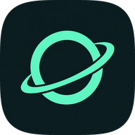

# Otrion

Otrion is an open-source IDE built on Code - OSS, the open-source project behind Visual Studio Code. You can chat with Codex or Claude Code alongside your editor through the Agent Client Protocol (ACP), whether your project is on your computer or on a remote host using Otrion Remote SSH.

## Get started

1. Download the desktop app for macOS, Windows, or Linux from [Otrion Releases](https://github.com/aesthetics-of-record/otrion/releases/latest).
2. Open a project and go to **Otrion Settings → Agents** to install and enable your preferred agent.
3. Open the chat sidebar and select **+** to start a session.

To build Otrion from source or work on its built-in extensions, see the [development guide](docs/otrion/development.md). For bug reports and pull requests, see [Contributing](CONTRIBUTING.md).

## License

Otrion uses the MIT license. The repository includes the upstream copyright notice and third-party attributions. [License](LICENSE.txt) · [Third-party notices](ThirdPartyNotices.txt)
